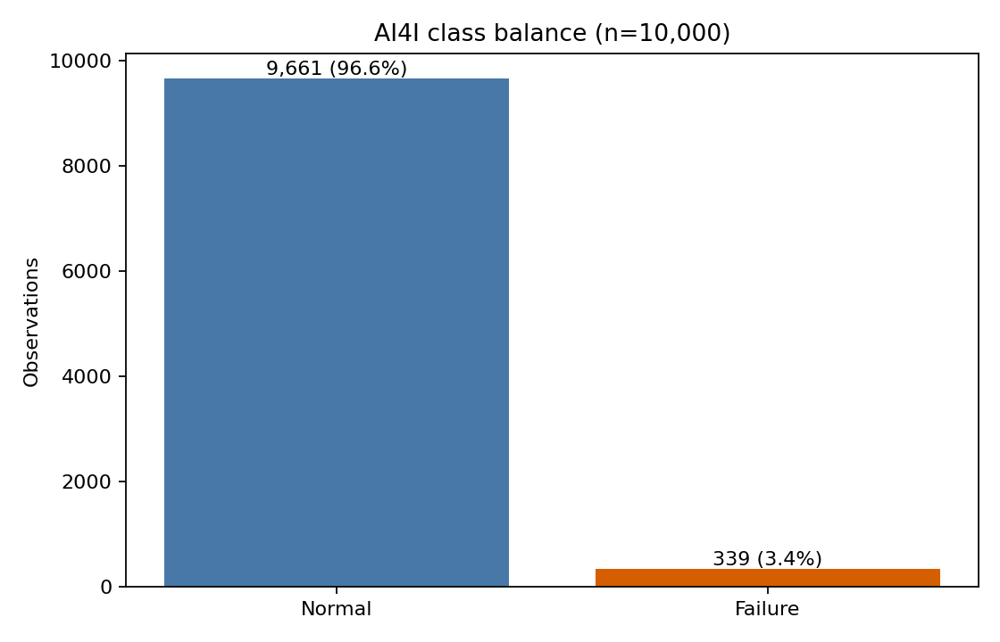
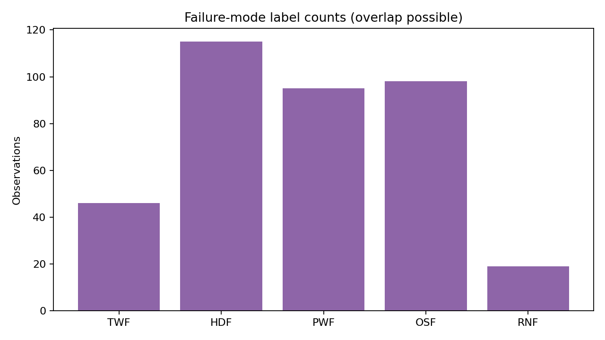
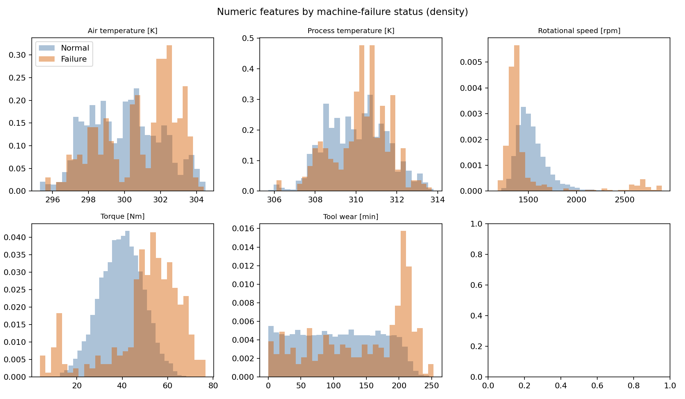
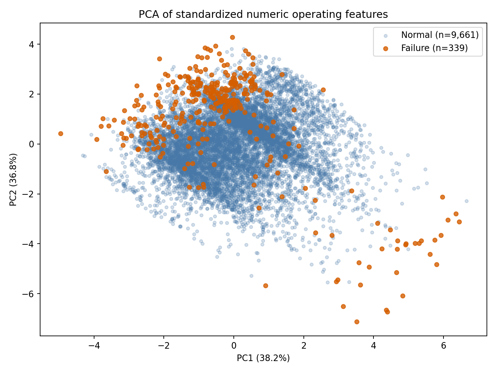
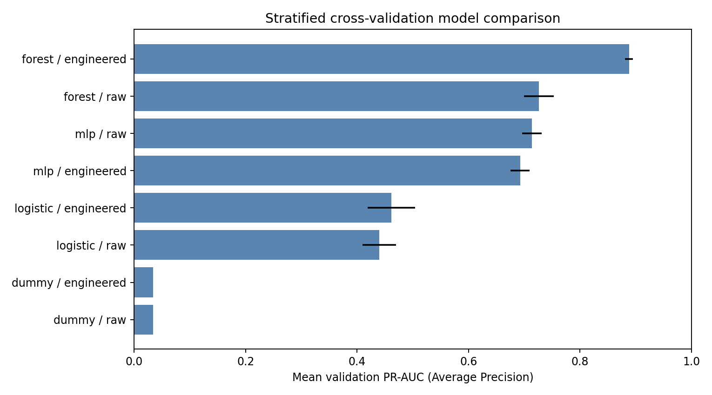
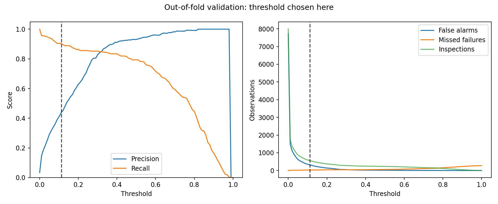
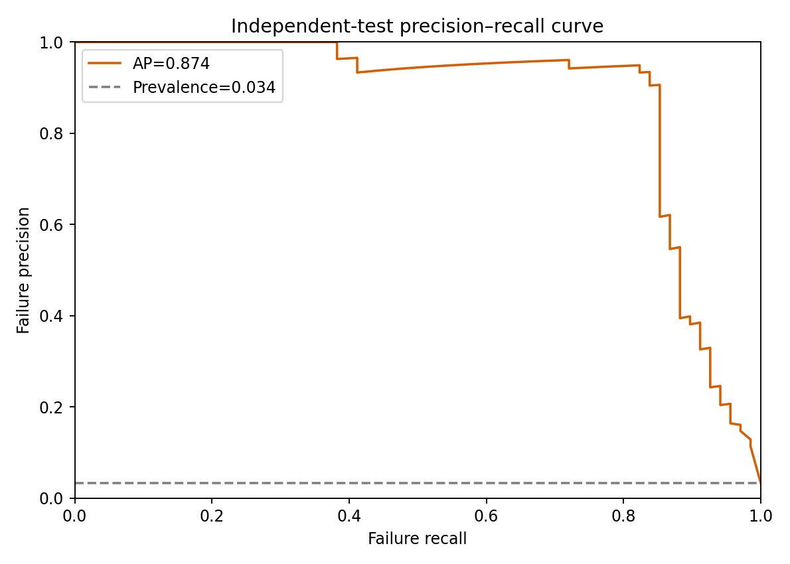
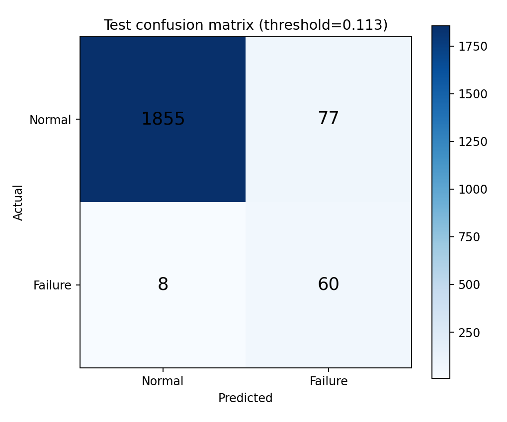
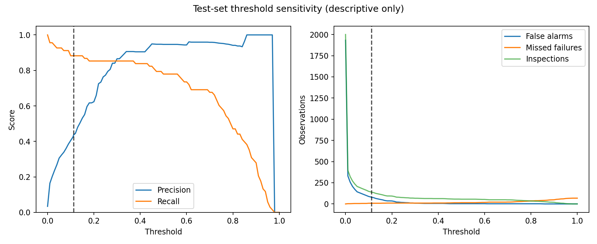

# 以類別加權模型分析 AI4I 2020 設備故障

## 摘要

本研究使用 UCI AI4I 2020 Predictive Maintenance Dataset 的 10,000 筆合成資料，分析設備運作特徵及當筆故障狀態。資料中的 339 筆故障僅占 3.39%，因此以故障類別的 PR-AUC（Average Precision）比較模型，並在驗證資料上選擇偏重降低漏報的判定門檻。研究以測試導向開發（TDD）建立資料契約、前處理、切分與評估測試，比較基準、邏輯斯迴歸、隨機森林及多層感知器（MLP），各自使用原始與衍生特徵。三折交叉驗證選出衍生特徵的隨機森林；獨立測試集 PR-AUC 為 0.8737，在預先選定門檻下故障 Recall 0.8824、Precision 0.4380，68 筆故障中抓到 60 筆，另有 77 筆誤報。資料列順序切分的敏感度實驗顯示表現會變動，因此結果不應直接視為真實設備的未來預警能力。

## 1. 背景與研究問題

設備故障相對罕見，只看準確率容易掩蓋漏報。本研究的問題是：使用當筆觀測到的產品類型、溫度、轉速、扭矩與磨耗，能否辨識 `Machine failure`？在重視故障漏報的條件下，會產生多少誤報及額外檢查？資料為合成資料，沒有明確的預測時間窗，因此研究範圍是當筆故障分類，不推論提前預警時數或剩餘壽命。

## 2. 資料與品質稽核

資料取自 UCI Machine Learning Repository 的 AI4I 2020（ID 601），採 CC BY 4.0 授權。原始 CSV 已保存於 [`data/ai4i/`](../data/ai4i/)，並記錄 SHA-256 供核對。資料有 10,000 筆、14 欄，沒有缺失值或完整重複列。正常 9,661 筆、故障 339 筆，故障比例 3.39%。產品類型 H、L、M 分別有 1,003、6,000、2,997 筆，觀察到的故障率分別為 2.09%、3.92%、2.77%。

主要輸入欄位為 `Type`，空氣溫度 [K]、製程溫度 [K]、轉速 [rpm]、扭矩 [Nm]、刀具磨耗 [min]。`UDI` 與 `Product ID` 僅作識別；TWF、HDF、PWF、OSF、RNF 是故障模式結果標籤，不進入預測 `Machine failure` 的特徵矩陣。

五種模式標籤的陽性筆數分別為 46、115、95、98、19；有 24 筆帶多個模式標籤。原始資料另有 9 筆 `Machine failure=1` 卻沒有任何模式標籤，及 18 筆帶模式標籤但 `Machine failure=0`。這些例外保留於原始資料並公開稽核，不以人工規則改寫標籤。詳細模式共現與數值範圍見 [`data_audit.json`](../results/ai4i/data_audit.json)。

## 3. 探索性 PCA

以五個數值運作特徵標準化後進行二維 PCA。PC1 與 PC2 分別解釋 38.21% 和 36.82% 的變異，累積為 75.03%。故障點在投影中較分散，與正常點仍有大量重疊；PCA 最大化資料變異，並非以區分類別為目的。此 PCA 只作探索與視覺化，沒有加入分類模型，也沒有使用識別欄或目標標籤當輸入。

## 4. 方法與 TDD

先寫資料 schema、標籤排除、衍生特徵、分層切分、訓練折擬合、權重及 PR-AUC／混淆矩陣的測試。Red 階段因 AI4I 模組尚不存在而失敗；完成最小實作後進入 Green，最後整理流程並加入從原始資料重建所有成果的整合測試。最終 AI4I 九項測試全部通過。

資料以固定種子 42 做 80/20 分層切分，訓練 8,000 筆、獨立測試 2,000 筆（68 筆故障）。模型選擇僅使用訓練集的三折分層交叉驗證。`Type` 以 one-hot 編碼，數值特徵以 StandardScaler 處理，轉換器置於 Pipeline，每一折只擬合對應的訓練資料。類別權重也依每一訓練折的標籤比例單獨計算，不進行過採樣、欠採樣或合成樣本。邏輯斯迴歸與隨機森林使用 `class_weight`；MLP 將同一組權重映射到每筆訓練樣本的 `sample_weight`；無資訊基準模型以訓練折的故障先驗比例輸出固定分數。

除六個原始輸入外，另測試三個物理衍生特徵：製程與空氣溫差 `T_process − T_air` [K]；功率 `torque × rpm × 2π/60` [W]；磨耗與扭矩乘積 `tool wear × torque` [min·Nm]。MLP 使用 24、12 神經元的 ReLU 隱藏層、Adam、batch size 128、學習率 0.003、L2 係數 0.01、最多 180 輪；隨機森林使用 120 棵樹與最小葉節點 2 筆。完整設定見 [`experiment_config.json`](../results/ai4i/experiment_config.json)。

## 5. 模型比較與門檻選擇

以三折驗證 PR-AUC 平均值排序：

| 模型與特徵 | 驗證 PR-AUC 平均值 | 標準差 |
|---|---:|---:|
| 隨機森林＋衍生特徵 | 0.8879 | 0.0073 |
| 隨機森林＋原始特徵 | 0.7262 | 0.0271 |
| MLP＋原始特徵 | 0.7138 | 0.0178 |
| MLP＋衍生特徵 | 0.6928 | 0.0171 |
| 邏輯斯迴歸＋衍生特徵 | 0.4617 | 0.0426 |
| 邏輯斯迴歸＋原始特徵 | 0.4399 | 0.0299 |
| 先驗比例基準 | 0.0339 | 約 0.0002 |

選定隨機森林＋衍生特徵後，使用訓練資料的 out-of-fold 分數選門檻：在驗證 Recall 至少 90% 的候選門檻中，取 Precision 最高者，門檻為 0.1131。測試集標籤未參與選模或選門檻。

## 6. 獨立測試結果與錯誤分析

| 指標 | 結果 |
|---|---:|
| PR-AUC / Average Precision | 0.8737 |
| ROC-AUC | 0.9779 |
| 故障 Precision | 0.4380 |
| 故障 Recall | 0.8824 |
| 故障 F1 | 0.5854 |
| 正確辨識故障 TP | 60 |
| 漏報 FN | 8 |
| 誤報 FP | 77 |
| 正確排除 TN | 1,855 |
| 預期檢查量（預測為故障） | 137 / 2,000 |

只按訓練集故障比例輸出常數的基準模型，測試 PR-AUC 約為 0.034。預定的 90% 驗證 Recall 目標在獨立測試集得到 88.24%，說明驗證結果不能保證部署後表現。降低漏報的門檻提高了檢查量：137 筆警報中 60 筆確實故障，77 筆為誤報。沒有真實維修成本資料，因此不將此門檻宣稱為成本最優。

Permutation importance 以測試集 PR-AUC 下降幅度作事後解釋，轉速、溫差與磨耗×扭矩的影響較大。這個解釋步驟沒有用來重新選模型，但測試集的重要性估計仍有抽樣不確定性。錯誤紀錄以 UDI 供查核，見 [`error_cases.csv`](../results/ai4i/error_cases.csv)。

## 7. 順序切分敏感度與限制

另以前 80% 資料列訓練、後 20% 測試，套用原先選定的模型形式與門檻。順序測試集有 39 筆故障，PR-AUC 0.7760、Recall 0.7436、Precision 0.3919，漏報 10 筆、誤報 45 筆。這表明切分方式會影響結果；原資料並非已驗證的真實機台時間序列，因此此檢查不等於嚴格的未來預測實驗。

資料為合成資料，少數類別只有 339 筆，且整體故障與模式標籤存在上述例外。物理衍生特徵與生成機制可能高度相符，測試表現不能直接外推到真實工廠。下一步可在有機台識別、時間戳、維修記錄與真實成本的資料上，建立按機台及時間隔離的外部驗證，並依實際漏報／誤報成本重新選門檻。

## 8. 結論

這個可重現流程顯示，對 AI4I 2020 的當筆故障分類，衍生特徵與類別加權隨機森林在 PR-AUC 上優於比較模型。漏報優先的驗證門檻在獨立測試集辨識 60/68 筆故障，同時產生 77 筆誤報。模型選擇、門檻決策和最終測試各有清楚的資料邊界，資料、程式、測試及圖表均可由專案內原始 CSV 重建。

## 參考資料

1. AI4I 2020 Predictive Maintenance Dataset [Dataset]. UCI Machine Learning Repository (2020). https://doi.org/10.24432/C5HS5C
2. Matzka, S. (2020). Explainable Artificial Intelligence for Predictive Maintenance Applications. International Conference on Artificial Intelligence for Industries.
3. Pedregosa, F., et al. (2011). Scikit-learn: Machine Learning in Python. Journal of Machine Learning Research, 12, 2825–2830.
