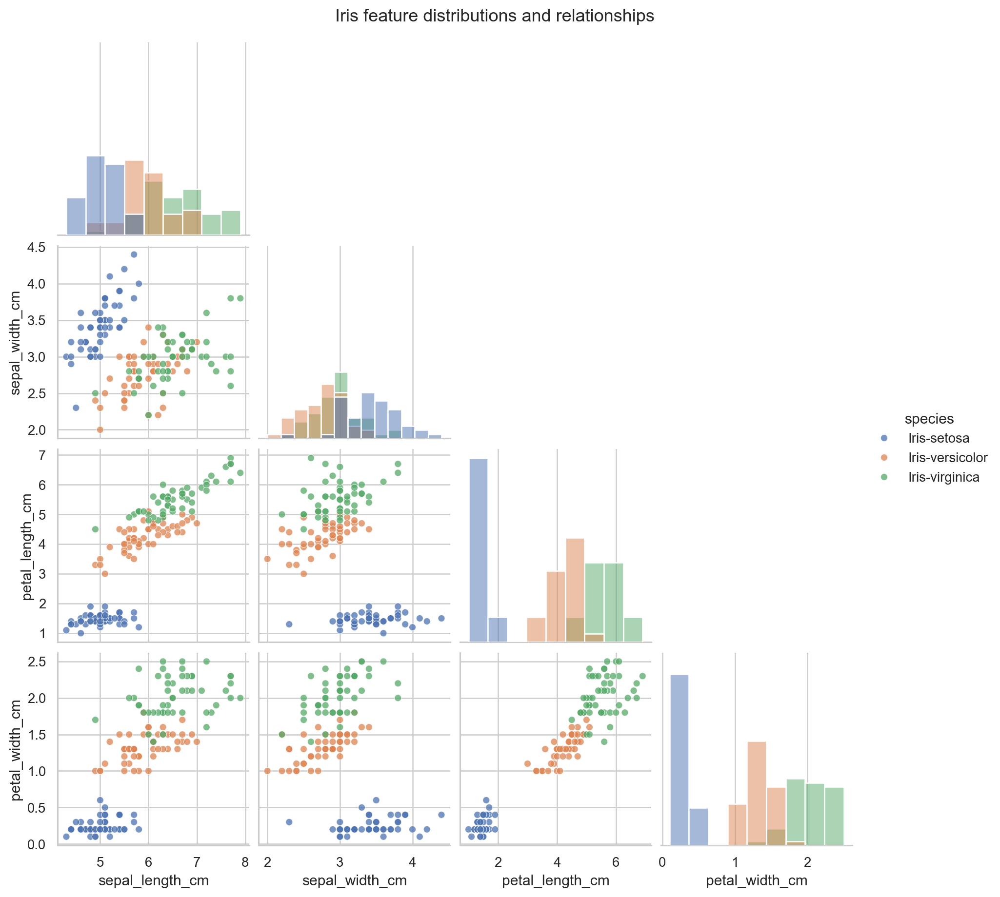
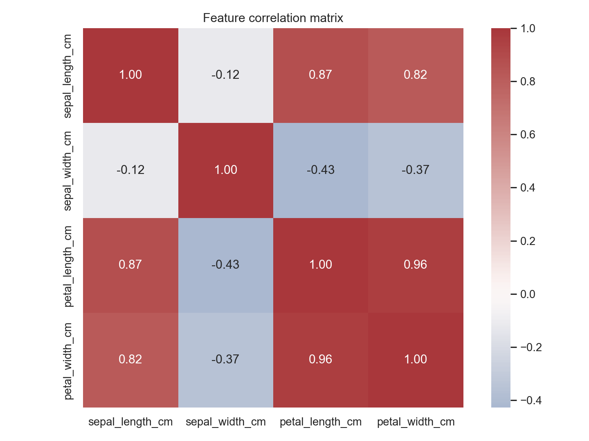
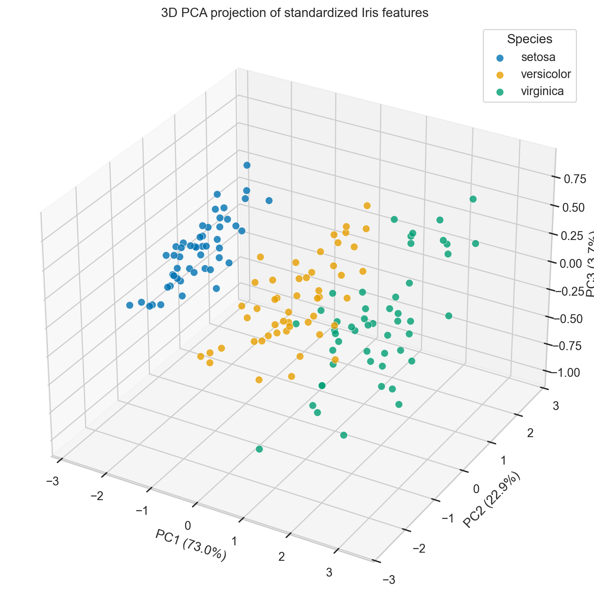
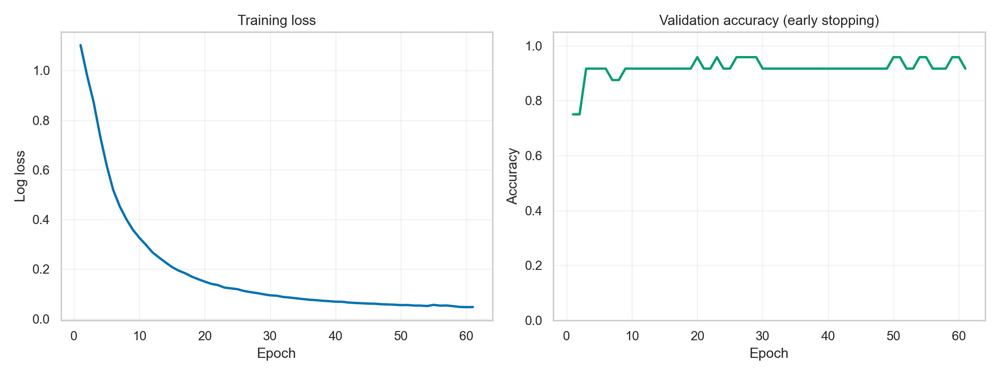
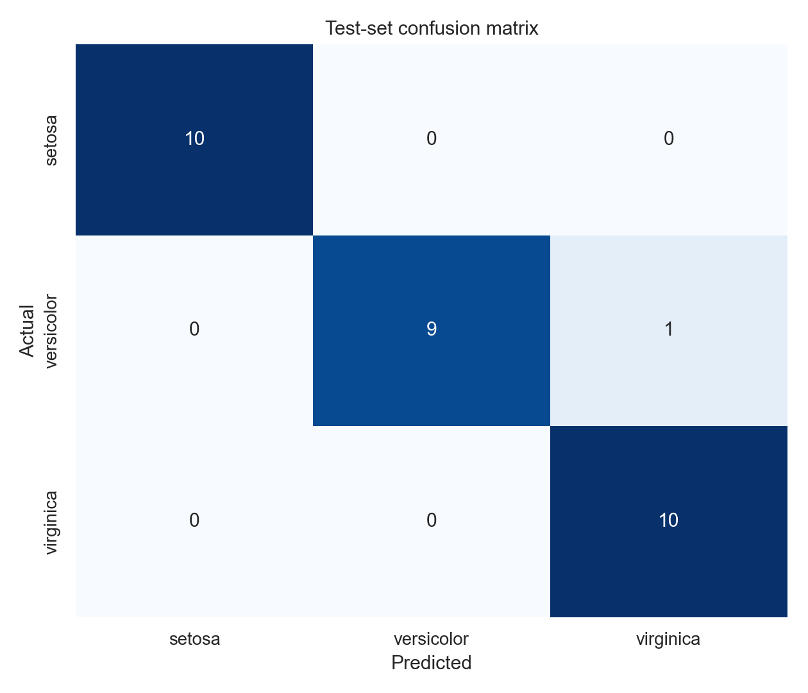

# 以主成分分析與類神經網路進行 Iris 花卉分類

## 摘要

本研究使用 UCI Machine Learning Repository 的 Iris Dataset，探討四項花萼與花瓣量測特徵對三種 Iris 花卉分類的辨識能力。研究先進行資料品質檢查與探索性分析，再以標準化與主成分分析（PCA）呈現三維特徵分布，最後建立含兩個隱藏層的多層感知器類神經網路。資料以固定隨機種子 42 進行 80%/20% 分層切分，所有預測用標準化參數僅由訓練資料估計，以避免資料洩漏。模型在 30 筆測試資料上得到 96.67% 準確率與 96.66% Macro F1；前三個主成分合計解釋 99.48% 的特徵變異。結果顯示，此小型神經網路能有效區分三個類別，主要誤差出現在特徵較相近的 versicolor 與 virginica 之間。

## 1. 研究背景與目的

Iris Dataset 是統計分類與機器學習教學中的經典資料集。每筆資料代表一株鳶尾花，包含花萼長度、花萼寬度、花瓣長度與花瓣寬度。本研究目的為：（1）建立可重現的資料品質與探索流程；（2）使用 PCA 檢視資料在低維空間中的類別結構；（3）以類神經網路完成三分類並量化泛化表現；（4）以測試導向開發確保資料契約、切分方法、前處理與產出物符合預期。

## 2. 資料集介紹

資料取自 UCI Iris Dataset（ID 53），共 150 筆觀測值與 4 個連續數值特徵，量測單位均為公分：

| 特徵 | 說明 |
|---|---|
| `sepal_length_cm` | 花萼長度 |
| `sepal_width_cm` | 花萼寬度 |
| `petal_length_cm` | 花瓣長度 |
| `petal_width_cm` | 花瓣寬度 |

目標欄位為 `species`，包含 Iris-setosa、Iris-versicolor 與 Iris-virginica，各 50 筆，類別完全平衡。資料沒有缺失值；發現 1 筆完整重複列。由於本研究目的包含忠實重現官方資料，且重複可能代表不同個體具有相同量測結果，因此不逕自刪除，但將其列入資料品質說明。

四個特徵的平均值依序為 5.8433、3.0573、3.7580 與 1.1993 cm。花瓣長度與寬度呈現明顯正相關，也是類別分群的重要訊號。

## 3. 研究方法

### 3.1 測試導向開發

開發流程先建立會失敗的測試，規範資料應有 150 筆、固定欄位、三個平衡類別、無缺失值、可重現的分層切分，以及包含 `StandardScaler` 與 MLP 的 Pipeline。完成最小實作後讓核心測試通過，再執行實驗並驗證 Accuracy 門檻、混淆矩陣維度與 PCA 解釋變異的一致性。最終 5 個測試全部通過。

### 3.2 PCA

PCA 前先以全資料各特徵的平均值與標準差進行標準化。PCA 在本研究中只用於無監督探索與視覺化，不參與測試集預測。PC1、PC2、PC3 分別解釋 72.96%、22.85%、3.67% 的變異，累積解釋率為 99.48%。

圖中 setosa 與另外兩類明顯分離；versicolor 與 virginica 整體仍可區分，但邊界附近存在部分重疊，預期會是分類誤差的主要來源。

### 3.3 資料切分與模型

資料採 80% 訓練、20% 測試的分層隨機切分，隨機種子固定為 42，因此訓練集與測試集分別有 120 與 30 筆，每類測試樣本各 10 筆。`StandardScaler` 與 `MLPClassifier` 置於同一 Pipeline；縮放器只透過訓練資料擬合，測試資料只執行 transform，避免資料洩漏。

神經網路包含兩個隱藏層，神經元數為 16 與 8，啟用函數為 ReLU，以 Adam 最佳化多類別 log loss。Batch size 為 16，初始學習率為 0.01，L2 正則化係數為 0.001。最大訓練 epoch 為 1000，並從訓練集保留 20% 作 early-stopping 驗證；驗證分數連續 40 個 epoch 未改善即停止。實際訓練在第 61 個 epoch 結束，最佳驗證準確率為 95.83%。

## 4. 實驗結果

測試集整體結果如下：

| 指標 | 結果 |
|---|---:|
| Accuracy | 0.9667 |
| Macro Precision | 0.9697 |
| Macro Recall | 0.9667 |
| Macro F1 | 0.9666 |

各類別表現如下：

| 類別 | Precision | Recall | F1-score | Support |
|---|---:|---:|---:|---:|
| Iris-setosa | 1.0000 | 1.0000 | 1.0000 | 10 |
| Iris-versicolor | 1.0000 | 0.9000 | 0.9474 | 10 |
| Iris-virginica | 0.9091 | 1.0000 | 0.9524 | 10 |

30 筆測試資料中有 29 筆分類正確。唯一錯誤是 1 筆 Iris-versicolor 被判定為 Iris-virginica；setosa 與 virginica 的 Recall 均為 1.0。此結果與 PCA 圖形一致：setosa 形成獨立群集，而 versicolor 與 virginica 的特徵空間較接近。

## 5. 討論

本實驗顯示四項簡單形態量測已足以提供高度可辨識的分類訊號。PCA 的前三維保留 99.48% 變異，代表以三維圖形呈現時資訊損失很低；PC1 單獨即解釋約 72.96%，顯示資料存在強烈的主方向。然而，PCA 最大化整體變異而非類別間距，因此視覺上重疊並不等同於模型必然無法分類。

測試集僅 30 筆，單一錯誤即影響準確率約 3.33 個百分點，因此不宜將 96.67% 視為精確的母體效能估計。未來可採重複分層交叉驗證，報告平均值與標準差；也可比較邏輯斯迴歸、支援向量機與決策樹，判斷神經網路是否在此小型資料上具實質優勢。若進行超參數選擇，應另設驗證流程或使用巢狀交叉驗證，避免以測試集調參。

## 6. 結論

本研究完成 Iris 資料的保存、品質檢查、探索分析、3D PCA 視覺化與類神經網路分類。模型在固定且可重現的分層測試集上達到 96.67% Accuracy 與 96.66% Macro F1。PCA 與混淆矩陣共同指出，setosa 最容易辨識，而 versicolor 與 virginica 的交界是主要挑戰。專案以 Pipeline 控制前處理範圍，以固定隨機種子提升可重現性，並以 TDD 驗證核心假設與產出契約。

## 參考資料

1. Fisher, R. A. (1936). *The use of multiple measurements in taxonomic problems*. Annals of Eugenics, 7(2), 179–188.
2. Fisher, R. A. (1936). *Iris* [Dataset]. UCI Machine Learning Repository. https://doi.org/10.24432/C56C76
3. Pedregosa, F., et al. (2011). *Scikit-learn: Machine Learning in Python*. Journal of Machine Learning Research, 12, 2825–2830.

